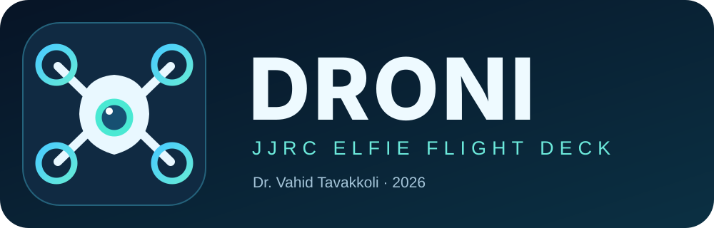

<p align="center">
  
</p>

<p align="center">
  <a href="https://github.com/vtavakkoli/Droni/actions/workflows/android-ci.yml"></a>
  
  
  
  
</p>

<h1 align="center">Droni</h1>
<p align="center"><strong>Native Android flight deck for the JJRC Elfie Wi‑Fi drone</strong><br/>
<strong>Created by Dr. Vahid Tavakkoli · © 2026</strong></p>

Droni brings hands-on flight control, first-person video, camera recording, a draw-to-preview mission designer, and clear diagnostics into a polished, privacy-friendly Android application. Built from the original <a href="https://github.com/vtavakkoli/jjrc-elfie">JJRC Elfie Python controller</a> and the decompiled legacy Android flight protocol.

## What's inside

| Screen | Capabilities | Status |
| :-- | :-- | :-- |
| **Splash + Home** | Branded splash, refined home with quick-access cards | Implemented |
| **Drone Fly** | Transparent dual-joystick FPV layout, takeoff, land, motor stop, speed, headless, disarmed calibration, reversal | Implemented; physical validation needed |
| **Draw Path** | Finger-drawn route, constrained preview, animated simulation | Implemented |
| **Experimental Path Trial** | Auto-connect + 5 s → speed 1 → calibrate + 3 s → takeoff + 3 s → 100% up for 300 ms → route at 75% with 300 ms gaps → landing request and reply check | **OPEN LOOP. Not real path following; safety/landing unverified** |
| **Recordings** | MP4 capture, asynchronous video library, thumbnails, play and share | Implemented; verify with real camera |
| **Settings** | Original manual flight preferences plus independent Draw Path startup, movement, response-log and camera settings | Implemented |
| **About** | Project credits, copyright, source and license | Implemented |

### Why Droni does not claim autonomous path following

**The JJRC Elfie does not supply verified GPS, optical-flow position, heading, IMU, barometer, or touchdown telemetry over this Wi‑Fi protocol.** The older sensor diagnostic did not confirm any inertial measurements. Sending a `calibrate` flag only requests sensor leveling — it cannot establish a world coordinate system or detect where the drone is.

A drawn screen line cannot be translated to meters without pose/velocity feedback. Droni therefore offers (1) **offline path simulation**, and (2) a deliberately explicit, tightly bounded, supervised **open-loop experimental trial**. The latter executes directional *pulses*, not actual waypoint tracking; wind, heading, scale, and inertia will alter the outcome. It requests landing at the end or upon cancellation but **cannot confirm landing**. For initial testing, **remove propellers**. Do not run an experimental trial around people, obstacles, indoors or over property.

## Android stack

- **Kotlin**, **Jetpack Compose**, **Material 3** — native reactive UI, no embedded web views
- **AndroidX Core SplashScreen 1.2.0** — official launch splash on Android 8.0+
- **Android ConnectivityManager** — explicitly selects drone Wi‑Fi even when that network has no internet
- **UDP 8080, 11-byte FF 08** — firmware-compatible original Android control packets, every ~25 ms
- **TCP 8888**, original Elfie handshake, **Android MediaCodec** for H.264 video
- **Android MediaMuxer + MediaStore** — camera MP4 recording to Movies/Droni without a third-party transcoder
- **JUnit + GitHub Actions** — protocol, H.264 parser and path-planner regression tests

No unnecessary trackers, location collection, accounts, or external cloud services.

### Interface

A shared native design system brings consistent typography, custom icons, rounded
surfaces and clear navigation to every screen. The flight deck keeps the camera
visible through its glass overlays. Recordings include local thumbnails, playback
and sharing. See [interface and screen review](docs/DESIGN.md) for details.

## Build and install

[](https://github.com/vtavakkoli/Droni/actions/workflows/android-ci.yml)

1. Open [GitHub Actions → Android CI](https://github.com/vtavakkoli/Droni/actions/workflows/android-ci.yml) and choose a **successful** run.
2. Download **droni-debug-apk** under Artifacts, unzip, and install the APK on Android 8.0+.
3. Or build with Android Studio + JDK 17 and Android SDK 36:

```bash
git clone https://github.com/vtavakkoli/Droni.git
cd Droni
# With Gradle 9.5 installed:
gradle --no-daemon testDebugUnitTest assembleDebug
```

Gradle wrapper properties are provided; its binary bootstrap JAR is not committed. See [build details](docs/BUILD.md).

## Flight preferences

### Flight deck

The manual Flight Deck retains its working controls from before PR #10, with the requested **3-second** auto-calibration settling wait in version **0.3.2**. Connect first, then request takeoff and use the left stick to climb. **Settings → Flight deck** retains the original default speed (0/1/2) and optional auto-calibration. Automatic calibration is off by default; when enabled it waits **3 seconds** before requesting takeoff. The original calibration preference key is used again. The one-second calibration command pulse is followed by the remainder of the three-second settling wait before takeoff. Draw Path timings and upward pulses do not apply to this screen.

See the [comparison with the original app](docs/ORIGINAL_APP_AUDIT.md) for the verified core command layout and remaining feature differences, including trims, flips, phone tilt and camera mirroring. **AXIS NORM / AXIS REV** changes flight-axis direction; it is separate from camera mirroring.

### Draw Path

**Settings → Draw Path launch / movement** controls only the path trial:

| Setting | Default |
| :-- | :-- |
| Auto-connect before path launch | On |
| Connection wait, when not already connected | 5 seconds |
| Path speed | 1 |
| Calibrate before path | On |
| Calibration wait | 3 seconds |
| Takeoff wait | 3 seconds |
| Initial upward input | 100% for 300 ms, then neutral |
| Path movement strength | 75% of the stick range |
| Neutral gap between commands | 300 ms |
| Landing response check | 5 seconds |

Join the drone Wi-Fi on the phone first. The path trial opens the app connection if needed, calibrates, requests takeoff, applies the timed upward input, executes at most 24 directional pulses of 180 ms each, and requests landing. The packet sender expires both climb and horizontal path inputs independently of the UI. Direction vectors are normalized so diagonal movement also has 75% magnitude. This remains open-loop movement, without measured position or altitude.

Path values use separate persistent keys. **Reset Draw Path defaults** leaves manual flight preferences unchanged. A path trial restores the prior speed mode when it ends or is cancelled while connected. Older PR #10 shared launch values do not override the new path defaults. **REC MP4** stays on the flight header and Android Back returns to the menu.

### Incoming response checks

Droni listens on its outbound control socket and, when available, local UDP **8081**. It accepts packets only from the selected drone IP, sends the original read-only device/version requests at connection, and checks replies after each path phase. **Settings → Drone response checks → Share response log** exports recent phase checks and bounded raw response prefixes for troubleshooting.

**UDP response received is not a verified flight-command acknowledgement.** Identity replies, live video and echoed control packets do not confirm calibration, lift or touchdown. The current firmware's flight-ACK format is unverified; missing replies are logged without inventing successful flight.

## Connect a drone

1. Connect the phone to the **JJRC Elfie Wi‑Fi** and choose **Stay connected** if Android says it has no internet.
2. Launch **Droni → Drone Fly**. Connect to default `172.16.10.1` (or your Wi‑Fi gateway).
3. Before attaching propellers, test button effects and neutral-stick behavior.
4. In clear, safe conditions, use takeoff, manual sticks and land. The **MOTOR STOP** button stops motors and can cause an uncontrolled fall. Closing Droni does not guarantee a safe landing.
5. While receiving video, tap **REC MP4** to start and **STOP REC** to save. Open **Recordings** to view saved clips. MP4 timestamp and camera format assumptions must be validated on hardware.

### Protocol reference

| Channel | Value |
| :-- | :-- |
| Drone Wi‑Fi gateway (default) | `172.16.10.1` |
| Flight | UDP `8080` · 11-byte `FF 08` + complement checksum |
| Control period | Approx. 25 milliseconds (40 Hz), not a real-time guarantee |
| Camera | TCP `8888` · proprietary 106-byte greeting · H.264 Annex-B |
| Sensor telemetry | **Not verified** |
| Path-tracking accuracy | **Not available without position feedback** |

The control UI's “connected” indicator means sockets are configured and local packets are being sent; **there is no drone acknowledgement or sensor validation**.

## Project map

```text
app/src/main/java/at/droni/
├── MainActivity.kt          # Existing FPV joystick flight deck
├── DroniApp.kt              # Splash destination, menu, settings, path, recordings, about
├── protocol/ElfieProtocol.kt
├── net/DroneController.kt
├── mission/PathPlanner.kt   # Unit-tested bounded path planner, no GPS claims
├── settings/DroniSettings.kt
└── video/
    ├── ElfieVideo.kt        # Original camera handshake + MediaCodec
    ├── AnnexBParser.kt
    └── ElfieMp4Recorder.kt  # Local MP4 remux + MediaStore
```

## Documentation & contribution

- [Safety and experimental mission limitations](docs/SAFETY.md)
- [Architecture and protocol](docs/ARCHITECTURE.md)
- [Development and CI](docs/BUILD.md)
- [Contributing](CONTRIBUTING.md)
- [Security policy](SECURITY.md)

---

**© 2026 Dr. Vahid Tavakkoli.** [MIT License](LICENSE). JJRC Elfie is a third-party product; this is an independent experimental controller, not endorsed by the manufacturer.
